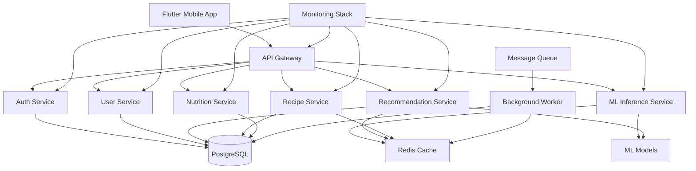
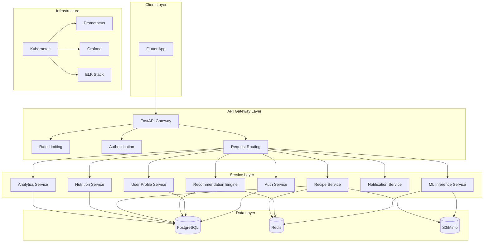
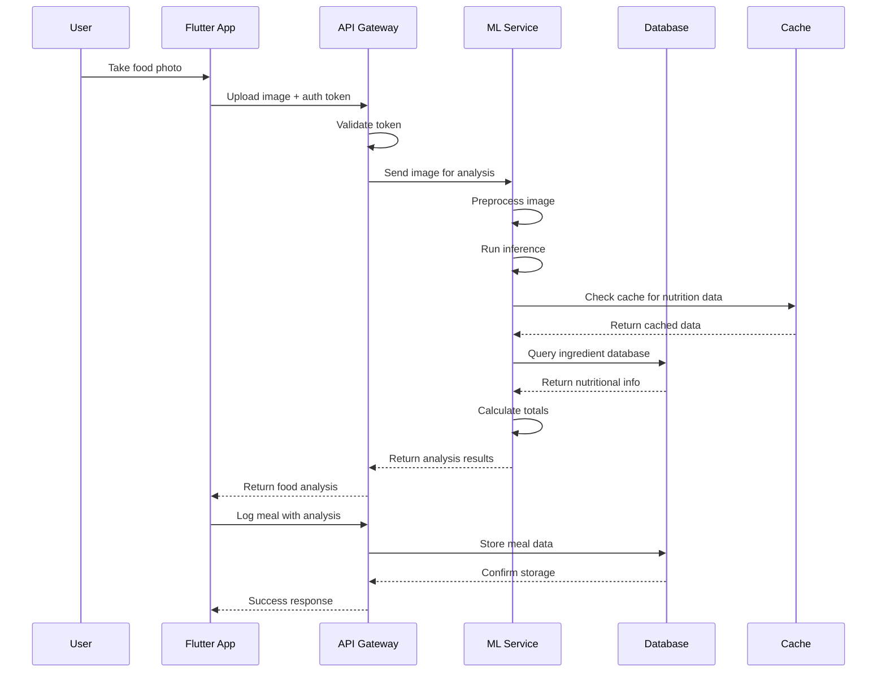
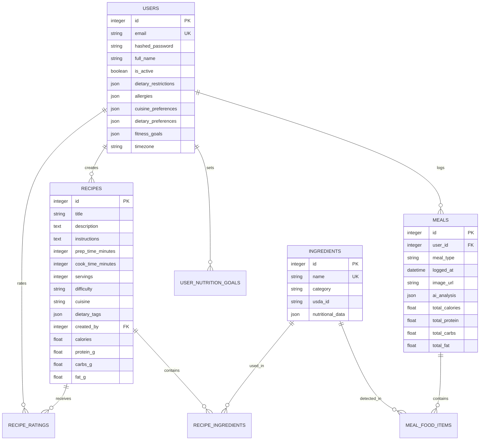
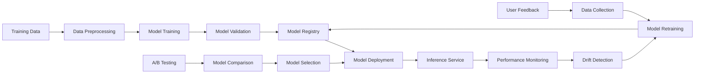
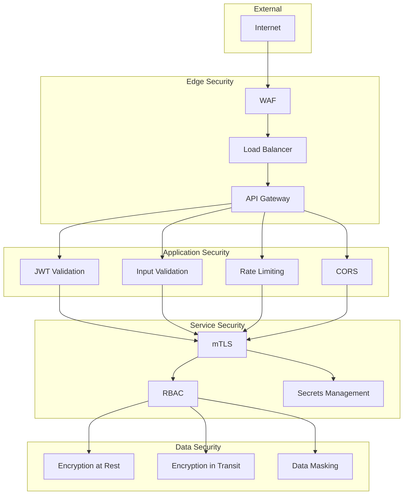
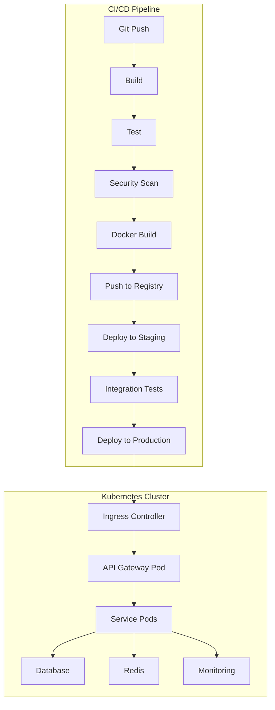

# System Architecture

## High-Level Architecture

## Component Diagram

## Data Flow Diagram

## Database Schema

## ML Pipeline Architecture

## Security Architecture

## Deployment Architecture

